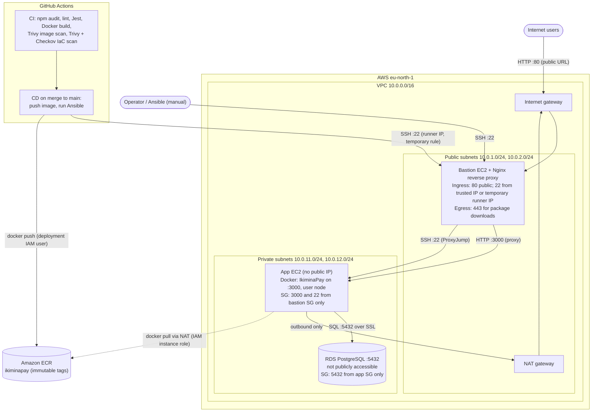

# IkiminaPay

> Digital savings groups (ikimina) made simple, transparent, and mobile-money ready.

## What IkiminaPay does

In Rwanda and across Africa, millions of people save through community savings groups, known in Rwanda as **ikimina**. Members contribute a fixed amount regularly, and the pooled money supports members when they need it.

Most groups still track contributions in paper notebooks or WhatsApp messages. Records get lost or miscalculated, members cannot easily check who has paid, which leads to disputes, and the treasurer does all the totals by hand.

IkiminaPay gives savings groups one shared digital record of members, contributions and balances:

- **Create a group:** a treasurer creates a savings group.
- **Add members:** the treasurer adds members to the group.
- **Record contributions:** each member's payment is saved to the group's records.
- **View balances:** members see their own total and the group balance.
- **MoMo payment simulation:** a successful simulated payment is saved as a contribution; a failed one changes nothing.
- **Planned:** user accounts and a real mobile money integration.

One Express app serves both the web page and the REST API. Data is stored in **PostgreSQL** (Amazon RDS in production). This is a demo: there is no login, and no real money is moved.

### Target users

- Treasurers who create and manage savings groups.
- Group members who pay contributions and check their savings and the group balance.
- Community savings groups in Rwanda and across Africa, including members with little technical experience.

### Team members

- Frida Kayiranga - f.kayiranga@alustudent.com
- Karabo Divine - k.divine@alustudent.com
- Noel Ishimwe - n.ishimwe4@alustudent.com
- IRADUKUNDA Ibrahim - i.ibrahim@alustudent.com

### Technology stack

| Area | Details |
|------|---------|
| Backend | Node.js, Express |
| Frontend | HTML, CSS, JavaScript (served by the same Express app) |
| Database | PostgreSQL (`pg` driver); Amazon RDS in production |
| Testing and linting | Jest, ESLint |
| Containers | Docker (`node:22-bookworm-slim`, runs as non-root user `node`), Docker Compose |
| Cloud | AWS VPC, EC2 (Amazon Linux 2023), RDS PostgreSQL, ECR, NAT gateway |
| Infrastructure as Code | Terraform |
| Configuration and deployment | Ansible, GitHub Actions, dedicated AWS IAM deployment user |
| Security scans | npm audit, Trivy (image and IaC), Checkov |

## Architecture



How to read it:

- **Public traffic:** users open the public URL (the bastion's public IP on port 80). Nginx on the bastion forwards the request to the app on port 3000 in the private subnet.
- **Admin traffic:** SSH is only allowed into the bastion, and only from one trusted IP (`ssh_allowed_cidr`) or, during a deployment, the GitHub runner's IP for a few minutes. The app VM accepts SSH only from the bastion (ProxyJump).
- **Database:** RDS sits in the private subnets and only accepts connections on 5432 from the app's security group.
- **Images:** GitHub Actions pushes the image to ECR using the dedicated deployment IAM user's GitHub Actions secrets. The app VM pulls it through the NAT gateway using its instance role (no AWS keys on the server).

## Live URL

**Live application:** http://16.171.116.2

Health check: `http://16.171.116.2/health`

This address matches the current `terraform output -raw bastion_public_ip`. If the bastion is replaced, update the URL from the new Terraform output.

## Run locally

### Prerequisites

- Git
- [Docker Desktop](https://www.docker.com/products/docker-desktop/) (includes Docker Compose)
- Node.js 20 or newer (includes npm), for running without Docker, linting and tests

```bash
git clone https://github.com/Ibrahim-Iradukunda/IkiminaPay.git
cd IkiminaPay
cp .env.example .env          # Windows PowerShell: Copy-Item .env.example .env
```

Edit `.env` and set your own local password. Never commit `.env`.

### Option 1: npm + a local PostgreSQL container

Start PostgreSQL in Docker (the values must match your `.env`):

```bash
docker run -d --name ikiminapay-db \
  -e POSTGRES_DB=ikiminapay \
  -e POSTGRES_USER=ikiminapay_user \
  -e POSTGRES_PASSWORD=change-me-local-password \
  -p 5432:5432 \
  -v ikiminapay-pgdata:/var/lib/postgresql/data \
  postgres:16
```

Then start the app:

```bash
npm install
npm start
```

With `DB_HOST=localhost` and `DB_SSL=false` in `.env`, the app connects, creates its tables automatically and listens on http://localhost:3000.

Stop and remove the database when finished: `docker rm -f ikiminapay-db` (add `docker volume rm ikiminapay-pgdata` to delete the data).

### Option 2: Docker Compose

```bash
docker compose up --build
```

Compose starts the app and a PostgreSQL service on a private bridge network. Inside Compose the app reaches the database by its service name, so `DB_HOST` is the database service name and `DB_SSL=false`.

- **Open the app:** http://localhost:3000
- **Check health:** `docker compose ps` shows the app as `healthy` once `/health` returns 200.
- **Stop:** `Ctrl + C` or `docker compose down`
- **Delete the database data:** `docker compose down -v`

### Lint and tests

```bash
npm run lint
npm test
```

Tests mock the database, so no PostgreSQL is needed to run them.

## Infrastructure (Terraform)

All AWS resources are defined in [`terraform/`](terraform/). See [`terraform/README.md`](terraform/README.md) for details.

| File | What it creates |
|------|-----------------|
| `network.tf` | VPC, 2 public + 2 private subnets, internet gateway, NAT gateway, route tables |
| `security.tf` | Security groups for the bastion, app and database |
| `compute.tf` | Bastion EC2, private app EC2, IAM instance role (ECR pull) |
| `database.tf` | Private, encrypted RDS PostgreSQL and its subnet group |
| `registry.tf` | Private ECR repository with immutable tags and scan on push |
| `outputs.tf` | Bastion IP, app private IP, ECR URL, DB endpoint, SG IDs |

1. Configure AWS CLI credentials and create an EC2 key pair in the region (default `eu-north-1`).
2. Create `terraform/terraform.tfvars` locally (git-ignored) with `key_name` and `ssh_allowed_cidr` (`x.x.x.x/32`). Pass the database password as an environment variable, never in a file:

   ```bash
   export TF_VAR_database_password='a-random-password-of-16-or-more-characters'
   ```

3. Run Terraform from the repository root:

   ```bash
   terraform -chdir=terraform init       # download the AWS provider
   terraform -chdir=terraform plan       # preview the changes
   terraform -chdir=terraform apply      # create the resources (costs money)
   terraform -chdir=terraform output     # print IPs, ECR URL, DB endpoint
   terraform -chdir=terraform destroy    # delete everything when finished
   ```

The NAT gateway, RDS and EC2 instances cost money while they run. `destroy` deletes the database without a final snapshot.

## Configuration and deployment (Ansible + CD pipeline)

Deployment is automatic: **when a pull request into `main` is merged**, [`.github/workflows/cd.yml`](.github/workflows/cd.yml) runs (a pull request that is closed without merging deploys nothing):

1. Runs the full CI workflow first; deployment stops if any check fails.
2. Authenticates to AWS using the dedicated deployment IAM user's `AWS_ACCESS_KEY_ID` and `AWS_SECRET_ACCESS_KEY` GitHub Actions secrets.
3. Builds the image and pushes it to ECR tagged with the commit SHA (immutable).
4. Temporarily allows SSH from the runner's IP on the bastion security group.
5. Runs [`ansible/deploy.yml`](ansible/deploy.yml) through the bastion:
   - **App VM:** installs Docker, the Docker Compose plugin and AWS CLI, reads the database credentials from AWS Secrets Manager into a root-only `/opt/ikiminapay/.env`, downloads Amazon's RDS CA bundle so the app verifies the database certificate (`DB_SSL_CA`), logs in to ECR, pulls the image, starts it with `docker compose up -d`, creates the tables (`data/init-db.js`) and waits until `/health` returns 200.
   - **Bastion:** installs Nginx and configures it to forward port 80 to the app on port 3000.
6. Removes the temporary SSH rule, even if a step failed. The bastion also has outbound TCP 443 for Amazon Linux package downloads.

To deploy manually, fill in `ansible/inventory.ini` from the Terraform outputs and follow [`ansible/README.md`](ansible/README.md).

### GitHub Actions deployment setup

The current workflow uses a dedicated, least-privilege IAM deployment user with an access key stored in GitHub Actions secrets. Its policy needs ECR push/describe access for the `ikiminapay` repository and permission to add and remove temporary SSH ingress on the bastion security group. The app EC2 instance uses its instance role to pull from ECR and read the database secret. Rotate the deployment access key if it is exposed or replaced.

Grant the deployment user only these actions:

- `ecr:GetAuthorizationToken` on `*`.
- `ecr:BatchCheckLayerAvailability`, `ecr:BatchGetImage`, `ecr:CompleteLayerUpload`, `ecr:DescribeImages`, `ecr:InitiateLayerUpload`, `ecr:PutImage` and `ecr:UploadLayerPart` on `arn:aws:ecr:<region>:<account-id>:repository/ikiminapay`.
- `ec2:AuthorizeSecurityGroupIngress` and `ec2:RevokeSecurityGroupIngress` on the bastion security group ARN.

In **Repository Settings → Secrets and variables → Actions**, add these **variables**:

| Variable | Value |
|----------|-------|
| `AWS_REGION` | Same region used by Terraform |
| `ECR_REPOSITORY_URL` | `terraform output -raw ecr_repository_url` |
| `BASTION_HOST` | `terraform output -raw bastion_public_ip` |
| `APP_PRIVATE_IP` | `terraform output -raw app_private_ip` |
| `BASTION_SECURITY_GROUP_ID` | `terraform output -raw bastion_security_group_id` |
| `DATABASE_SECRET_ID` | `terraform output -raw database_secret_id` (Secrets Manager secret containing database credentials) |

And these **secrets**:

| Secret | Value |
|--------|-------|
| `AWS_ACCESS_KEY_ID` | Access key ID for the dedicated deployment IAM user |
| `AWS_SECRET_ACCESS_KEY` | Secret access key for that user; never commit or paste it into the repository |
| `BASTION_SSH_PRIVATE_KEY` | Contents of the EC2 key pair's private key file. Never commit it. |
| `BASTION_SSH_KNOWN_HOSTS` | Verified host-key lines for the bastion (`ssh-keyscan -H <bastion-ip>`); check the fingerprint against AWS first. |

## CI and security scans

[`.github/workflows/ci.yml`](.github/workflows/ci.yml) runs on pull requests to `main`, on pushes to other branches, and as the first stage of every deployment.

| Job | Step | Fails the pipeline when |
|-----|------|-------------------------|
| `build-and-test` | `npm audit --audit-level=high` | A HIGH or CRITICAL dependency vulnerability exists |
| `build-and-test` | `npm run lint` (ESLint) | Any lint error |
| `build-and-test` | `npm test` (Jest) | Any test fails |
| `build-and-test` | `docker build` | The image does not build |
| `build-and-test` | Trivy image scan | HIGH or CRITICAL fixable vulnerabilities in the image |
| `terraform-scan` | Trivy config scan of `terraform/` | HIGH or CRITICAL misconfigurations |
| `terraform-scan` | Checkov | Fails the scan job when a policy check fails |

Branch protection on `main` requires a pull request with at least one approval from someone other than the author, up-to-date branches, resolved conversations, and passing `build-and-test` and `terraform-scan` checks.

**Where findings are documented:** every scan finding, its fix, and each accepted risk are recorded in [`SECURITY.md`](SECURITY.md).

## Health check

`GET /health` checks that the app is running **and** that PostgreSQL answers (`SELECT 1`).

| Situation | HTTP status | Response body |
|-----------|-------------|---------------|
| App and database OK | `200` | `{"status":"ok","database":"up"}` |
| Database unreachable | `503` | `{"status":"error","database":"down"}` |

```bash
curl -i http://localhost:3000/health
curl -i http://16.171.116.2/health
```

How to read it:

- **200:** everything is working.
- **503:** the app is running but cannot reach the database. Check the `DB_*` variables, the RDS status and the database security group. The app logs show `Health check failed:` with the reason.
- **No response / 502 from Nginx:** the app container is not running. On the app VM, check `docker ps` and `docker logs ikiminapay`.

The Ansible deployment waits for `/health` to return 200 before it finishes. At startup the app also creates its tables (`data/schema.sql`) and exits with an error if it cannot reach the database after several attempts.

## Environment variables

Copy `.env.example` to `.env` for local use. In production the values are provided by the deployment, never committed.

| Variable | Required | Description | Example / default |
|----------|----------|-------------|-------------------|
| `PORT` | No | Port the app listens on | `3000` |
| `DB_HOST` | Yes | PostgreSQL host (RDS endpoint in production) | `localhost` |
| `DB_PORT` | No | PostgreSQL port | `5432` |
| `DB_NAME` | Yes | Database name | `ikiminapay` |
| `DB_USER` | Yes | Database user | `ikiminapay_user` |
| `DB_PASSWORD` | Yes | Database password. Keep it secret. | *(set locally only)* |
| `DB_SSL` | No | SSL is **on** unless set to `false`. RDS requires SSL (`rds.force_ssl = 1`); use `false` only for local PostgreSQL. | on |
| `DB_SSL_CA` | No | Path to the RDS CA bundle. If the file exists, the server certificate is verified; otherwise SSL is used without verification and a warning is logged. | `certs/eu-north-1-bundle.pem` |
| `DB_CONNECT_RETRIES` | No | Database connection attempts at startup (3 seconds apart) | `5` |

`.env`, `*.tfvars` and `*.pem` are ignored by Git, and `.env` is also excluded from the Docker image by `.dockerignore`.

## API

| Method | Endpoint | Body | Description |
|--------|----------|------|-------------|
| POST | `/groups` | `{ "name": "..." }` | Create a group, returns its id |
| POST | `/groups/:id/members` | `{ "name": "..." }` | Add a member, returns their id |
| POST | `/groups/:id/contributions` | `{ "memberId": "...", "amount": 5000, "date": "YYYY-MM-DD" }` | Record a contribution (`amount` must be a positive number) |
| GET | `/groups/:id/summary` | none | Each member's total and the group balance |
| GET | `/health` | none | App and database health (see above) |

```bash
curl -X POST http://localhost:3000/groups -H "Content-Type: application/json" -d '{"name": "Abishyize Hamwe"}'
curl http://localhost:3000/groups/<groupId>/summary
```

Errors are returned as `{ "error": "..." }`.

## Project structure

```
.
├── .github/workflows/
│   ├── ci.yml                  # Audit, lint, tests, Docker build, Trivy and Checkov scans
│   └── cd.yml                  # On merge to main: ECR push + Ansible deployment
├── ansible/
│   ├── deploy.yml              # Configure the app VM (Docker) and bastion (Nginx)
│   ├── inventory.ini           # Manual deployment example; replace placeholders
│   └── templates/              # Production Compose and Nginx configuration
├── terraform/                  # VPC, subnets, bastion, app EC2, RDS, ECR, security groups
├── controllers/
│   └── groupController.js      # Handles requests for group endpoints
├── data/
│   ├── database.js             # PostgreSQL pool, SSL settings, health and schema helpers
│   ├── init-db.js              # Applies the schema (used by the Ansible deployment)
│   └── schema.sql              # Tables (CREATE TABLE IF NOT EXISTS), run at startup
├── public/                     # Web page served by Express
│   ├── index.html
│   ├── app.js
│   └── styles.css
├── routes/
│   └── groups.js               # Group endpoints (/groups)
├── services/
│   └── groupService.js         # Group logic and SQL queries
├── tests/                      # Jest tests (database is mocked)
│   ├── api.test.js             # API routes and /health (200 and 503)
│   ├── database.test.js        # Config checks, SSL modes, schema helper
│   └── groupService.test.js    # SQL queries and validation
├── app.js                      # Express app, routes and /health
├── server.js                   # Entry point: checks config, creates tables, starts server
├── Dockerfile                  # Container image (non-root, Node 22 slim)
├── docker-compose.yml          # Local app + database
├── .env.example                # Example environment variables (fake values)
├── eslint.config.js
├── package.json
├── SECURITY.md                 # Security policy: scan findings, fixes and accepted risks
├── CHANGELOG.md
├── LICENSE
└── README.md
```

## Links

- [Project Board](https://github.com/users/Karab-o/projects/2/views/1)
- [Changelog](CHANGELOG.md)
- [Security findings](SECURITY.md)

## License

MIT License. See [LICENSE](LICENSE).
