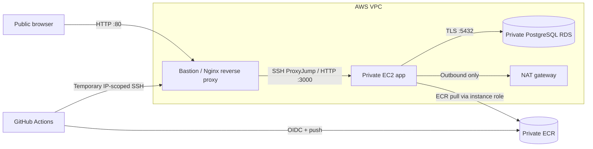

# IkiminaPay

> Digital savings groups (ikimina) made simple, transparent, and mobile-money ready.

## African Context

In Rwanda and across Africa, millions of people save through community savings groups, known in Rwanda as **ikimina**. Members contribute a fixed amount regularly, and the pooled money supports members when they need it.

Most groups still track contributions in paper notebooks or WhatsApp messages. Records get lost or miscalculated, members cannot easily check who has paid, which leads to disputes, and the treasurer does all the totals by hand. Most members already pay with mobile money (MoMo), but their savings records are not connected to it.

IkiminaPay gives savings groups one shared digital record of members, contributions and balances, so everyone can see where the group stands.

## Team Members

- Frida Kayiranga - Team Lead, core backend, project board, CI pipeline - f.kayiranga@alustudent.com
- Karabo Divine - README, setup steps, user stories, Docker Compose - k.divine@alustudent.com
- Noel Ishimwe - Frontend, Dockerfile and .dockerignore - n.ishimwe4@alustudent.com
- IRADUKUNDA Ibrahim - .gitignore, linting and unit tests, branch protection - i.ibrahim@alustudent.com

## Project Overview

IkiminaPay is a simple savings group tracker. A treasurer creates a group, adds members and records each contribution. Members can then see their own total and the group's balance.

The app is intentionally small. One Express app serves both the web page and the REST API, and group, member, and contribution records are stored in PostgreSQL. The mobile money action is a local simulation: a successful attempt is saved as a contribution, and a failed attempt does not change the balance.

The app is containerized with Docker and runs with a single `docker compose up` command. GitHub Actions runs lint, tests, dependency checks, container scanning, and Terraform scanning. A merge to `main` builds and publishes the image to ECR and deploys it to the private EC2 instance using Ansible. This is a demo: there is no login, and no real money is moved.

## Target Users

- Treasurers who create and manage savings groups.
- Group members who pay contributions and check their savings and the group balance.
- Community savings groups in Rwanda and across Africa, including members with little technical experience.

## Core Features

- **Create a group:** a treasurer creates a savings group.
- **Add members:** the treasurer adds members to the group.
- **Record contributions:** each member's payment is saved to the group's records.
- **View balances:** members see their own total and the group balance.
- **MoMo payment simulation:** a successful simulated payment is saved as a contribution; a failed one changes nothing.
- **Database:** the API stores group, member, and contribution records in private PostgreSQL RDS in production.
- **Planned:** user accounts and a real mobile money integration.

## Technology Stack

| Area | Details |
|------|---------|
| Backend | Node.js, Express |
| Frontend | HTML, CSS, JavaScript (served by the same Express app) |
| Database | PostgreSQL (managed RDS in production) |
| Testing and linting | Jest, ESLint |
| Containers | Docker (`node:22-bookworm-slim`, non-root user), Docker Compose |
| Cloud | AWS VPC, EC2, RDS PostgreSQL, ECR, NAT gateway |
| Configuration and deployment | Ansible, GitHub Actions, AWS OIDC |
| CI/CD | GitHub Actions: lint, tests, npm audit, Trivy, Checkov, ECR publish, Ansible deploy |
| Other | dotenv, Git and GitHub (Projects, branch protection, pull requests) |

## Getting Started

You can run IkiminaPay with Docker Compose (recommended) or directly with Node.js.

### Prerequisites

- Git
- [Docker Desktop](https://www.docker.com/products/docker-desktop/) (includes Docker Compose), for running with Docker
- Node.js 20 or newer (includes npm), for running without Docker, linting and tests

### Installation

Clone the repository:

```bash
git clone https://github.com/Ibrahim-Iradukunda/IkiminaPay.git
cd IkiminaPay
```

Create your environment file from the example:

```bash
cp .env.example .env
```

On Windows PowerShell, use `Copy-Item .env.example .env`.

### Run with Docker Compose (recommended)

Build the image and start the app:

```bash
docker compose up --build
```

Open http://localhost:3000.

- **Stop the app:** press `Ctrl + C`, or run `docker compose down`.
- **Check its health:** `docker compose ps` shows the container as `healthy` once the app responds.
- **Delete saved data:** `docker compose down -v` also removes the data volume.

What the Compose setup does:

| Setting | Purpose |
|---------|---------|
| `app` service | Built from the `Dockerfile`; initializes the schema and serves the API and web page. |
| `db` service | Local PostgreSQL 16 instance used by the API. |
| `ikiminapay-db-data` volume | Keeps local PostgreSQL data when containers are restarted or recreated. |
| `ikiminapay-net` network | Private bridge network connecting the app and database. |
| `env_file: .env` | Passes your settings into the container. `.env` is never copied into the image. |
| Health check | Calls `http://localhost:3000/` inside the app container every 30 seconds |
| `restart: unless-stopped` | Restarts the app if it crashes, but not after you stop it |

### Run without Docker

```bash
npm install
npm start
```

Open http://localhost:3000. Set up a local PostgreSQL instance and configure the `DB_*`
values in `.env` before running `npm start`; for local development, set `DB_SSL=false`.

### Environment Variables

| Variable | Description | Default |
|----------|-------------|---------|
| `PORT` | Port the app listens on (inside the container and on your computer) | `3000` |
| `DB_HOST`, `DB_PORT`, `DB_NAME`, `DB_USER`, `DB_PASSWORD` | PostgreSQL connection settings. Compose defaults to its `db` service. | See `.env.example` |
| `DB_SSL` | Set to `false` for the local Compose database; production uses verified TLS with `DB_SSL_CA`. | `false` locally |
| `DB_SSL_CA` | Path to the trusted RDS CA bundle when TLS is enabled. | Required for production |

Never commit your `.env` file. It is listed in `.gitignore` and `.dockerignore`.

## Usage

Use the web page at http://localhost:3000 to create a group, add members, record contributions and view balances. The browser remembers the active group, so you can reopen it on the same device.

You can also call the API directly:

| Method | Endpoint | Body | Description |
|--------|----------|------|-------------|
| POST | `/groups` | `{ "name": "..." }` | Create a group, returns its id |
| POST | `/groups/:id/members` | `{ "name": "..." }` | Add a member, returns their id |
| POST | `/groups/:id/contributions` | `{ "memberId": "...", "amount": 5000, "date": "YYYY-MM-DD" }` | Record a contribution (`amount` must be a number) |
| GET | `/groups/:id/summary` | none | Each member's total and the group balance |
| GET | `/health` | none | Readiness status for operators and deployment checks |

Example:

```bash
curl -X POST http://localhost:3000/groups -H "Content-Type: application/json" -d '{"name": "Abishyize Hamwe"}'
curl http://localhost:3000/groups/<groupId>/summary
```

Errors are returned as `{ "error": "..." }`.

## Linting and Tests

Install dependencies first with `npm install`, then:

```bash
npm run lint
npm test
```

ESLint checks code style and errors. Jest tests are in the `tests/` folder and cover the API, the group service and the data store.

## Continuous Integration

The reusable CI workflow in `.github/workflows/ci.yml` runs for pull requests to `main`,
pushes to non-main branches, and as a required stage of the production deployment:

- **Application checks:** `npm ci`, `npm audit`, ESLint, Jest, and a Docker build.
- **Container scan:** Trivy scans the built image and fails for HIGH or CRITICAL findings.
- **IaC scan:** Trivy scans Terraform and fails for HIGH or CRITICAL misconfigurations;
  Checkov provides supplemental findings.

Set the `build-and-test` and `terraform-scan` checks as required in branch protection.

## Architecture and infrastructure



Terraform configuration is in [`terraform/`](terraform/); the Ansible playbook and
inventory example are in [`ansible/`](ansible/). The bastion is the demo's public HTTP
endpoint and SSH jump host. The app EC2 instance and RDS database are private. Public
traffic is HTTP-only; configure a domain and TLS before treating this as a production
service. NAT gateway, RDS, EC2 instances, storage, and public IPv4 addresses can incur
ongoing AWS charges.

### Provision and configure

1. Create an AWS key pair in your chosen region and configure AWS CLI credentials.
2. Create `terraform/terraform.tfvars` locally (ignored by Git) with the key pair name,
   your public IP as `ssh_allowed_cidr` (`x.x.x.x/32`), region, and a random database
   password of at least 16 characters. See [`terraform/README.md`](terraform/README.md).
3. Run `terraform -chdir=terraform init`, `validate`, `plan`, review the costs, then
   `apply`. Do not apply until you are ready to incur AWS charges.
4. Configure the GitHub Actions AWS OIDC role and repository variables/secrets below.
5. On the first merge to `main`, the CD workflow publishes and deploys the app. The demo
   URL is `http://<bastion_public_ip>` from `terraform output`.
6. To deploy manually, populate `ansible/inventory.ini` and follow
   [`ansible/README.md`](ansible/README.md). Run `terraform destroy` when finished.

**Live application:** Not deployed from this workspace yet. After applying Terraform and
the first successful CD run, replace this line with `http://<bastion_public_ip>`.

### GitHub Actions deployment setup

Create an IAM OIDC provider for `https://token.actions.githubusercontent.com` if your
AWS account does not already have one. Create a role whose trust policy limits OIDC to
this repository's pull-request workflow subject. The CD workflow runs its deployment
jobs only when a pull request to `main` is closed as merged:

```json
{
  "Version": "2012-10-17",
  "Statement": [{
    "Effect": "Allow",
    "Principal": { "Federated": "arn:aws:iam::ACCOUNT_ID:oidc-provider/token.actions.githubusercontent.com" },
    "Action": "sts:AssumeRoleWithWebIdentity",
    "Condition": {
      "StringEquals": {
        "token.actions.githubusercontent.com:aud": "sts.amazonaws.com",
        "token.actions.githubusercontent.com:sub": "repo:Ibrahim-Iradukunda/IkiminaPay:pull_request"
      }
    }
  }]
}
```

Attach a least-privilege policy to that role: allow ECR image push actions on the
`ikiminapay` repository, `ecr:GetAuthorizationToken` on `*`, and
`ec2:AuthorizeSecurityGroupIngress` / `ec2:RevokeSecurityGroupIngress` only on the
Terraform-created bastion security group. The workflow briefly adds its runner's `/32`
address to that group for Ansible SSH and removes it afterward.

For the permissions policy, replace `REGION`, `ACCOUNT_ID`, and `BASTION_SG_ID` with
your AWS values:

```json
{
  "Version": "2012-10-17",
  "Statement": [
    {
      "Effect": "Allow",
      "Action": "ecr:GetAuthorizationToken",
      "Resource": "*"
    },
    {
      "Effect": "Allow",
      "Action": [
        "ecr:BatchCheckLayerAvailability",
        "ecr:CompleteLayerUpload",
        "ecr:DescribeImages",
        "ecr:InitiateLayerUpload",
        "ecr:PutImage",
        "ecr:UploadLayerPart"
      ],
      "Resource": "arn:aws:ecr:REGION:ACCOUNT_ID:repository/ikiminapay"
    },
    {
      "Effect": "Allow",
      "Action": [
        "ec2:AuthorizeSecurityGroupIngress",
        "ec2:RevokeSecurityGroupIngress"
      ],
      "Resource": "arn:aws:ec2:REGION:ACCOUNT_ID:security-group/BASTION_SG_ID"
    }
  ]
}
```

In **Repository Settings → Secrets and variables → Actions**, add these repository
variables:

| Variable | Value |
|----------|-------|
| `AWS_REGION` | Same region used by Terraform |
| `AWS_ROLE_ARN` | ARN of the OIDC role above |
| `ECR_REPOSITORY_URL` | `terraform output -raw ecr_repository_url` |
| `BASTION_HOST` | `terraform output -raw bastion_public_ip` |
| `APP_PRIVATE_IP` | `terraform output -raw app_private_ip` |
| `BASTION_SECURITY_GROUP_ID` | `terraform output -raw bastion_security_group_id` |
| `DATABASE_SECRET_ID` | `terraform output -raw database_secret_id` |

Add these repository **secrets**:

| Secret | Value |
|--------|-------|
| `BASTION_SSH_PRIVATE_KEY` | Contents of the EC2 key pair's private key file. Never commit or paste it into a tracked file. |
| `BASTION_SSH_KNOWN_HOSTS` | Verified SSH host-key lines for the bastion IP (`ssh-keyscan -H <bastion-ip>`); verify its fingerprint against AWS before saving. |

The workflow accepts the private app host key on first connection because it is only
reachable through the verified bastion. Use managed host certificates or a pre-populated
known-hosts entry for the app before production use.

## Project Structure

```
.
├── .github/
│   └── workflows/
│       ├── ci.yml              # Tests, dependency checks, image and IaC scans
│       └── cd.yml              # Main-branch ECR publish and Ansible deployment
├── ansible/
│   ├── deploy.yml              # Configure private app and bastion Nginx
│   ├── inventory.ini           # Local deployment example; replace placeholders
│   └── templates/              # Production Compose and Nginx configuration
├── controllers/
│   └── groupController.js      # Handles requests for group endpoints
├── data/
│   ├── database.js             # PostgreSQL connection pool with verified TLS
│   ├── init-db.js              # Applies the idempotent SQL schema
│   └── schema.sql              # PostgreSQL tables and indexes
├── public/                     # Web page served by Express
│   ├── index.html
│   ├── app.js
│   └── styles.css
├── routes/
│   └── groups.js               # Group endpoints (/groups)
├── services/
│   └── groupService.js         # Group logic: members, contributions, balances
├── tests/                      # Jest unit tests
│   ├── api.test.js
│   ├── groupService.test.js
│   └── store.test.js
├── app.js                      # Express app, API routes, and /health readiness endpoint
├── server.js                   # Entry point: loads .env and starts the server
├── Dockerfile                  # Container image (non-root, Node 22 slim)
├── .dockerignore               # Files kept out of the Docker image
├── docker-compose.yml          # Runs the app with a volume, network and health check
├── eslint.config.js            # Lint rules
├── .env.example                # Example environment variables
├── .gitignore
├── package.json
├── package-lock.json
├── terraform/                  # AWS VPC, EC2, RDS, ECR, security, and outputs
├── CHANGELOG.md                # F1, F2, and Summative milestones
├── LICENSE
└── README.md
```

## Collaboration and Repository Security

**Branch protection on `main`:** a pull request is required, with at least 1 approval from someone other than the author. Stale approvals are dismissed when new commits are pushed, branches must be up to date before merging, conversations must be resolved, and the rules apply to administrators too.

**Required status checks:** require the CI `build-and-test` and `terraform-scan` jobs to pass before a pull request can be merged into `main`.

**Secrets:** `.gitignore` and `.dockerignore` exclude `.env` files, `node_modules` and local data, so credentials and personal data never reach the repository or the Docker image.

**Workflow:** every change is made on its own branch, opened as a pull request, checked by CI, and reviewed by a teammate before merging. Work is tracked on the project board.

## Links

- [Project Board](https://github.com/users/Karab-o/projects/2/views/1)
- [Changelog](CHANGELOG.md)

## License

MIT License. See [LICENSE](LICENSE).
